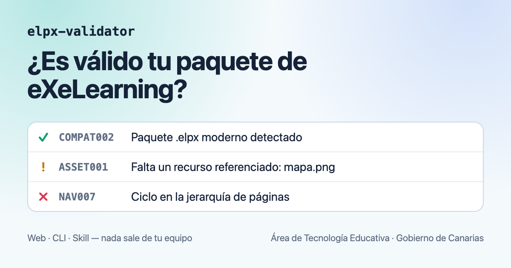

# elpx-validator

[](https://www.npmjs.com/package/elpx-validator)
[](https://github.com/ateeducacion/elpx-validator/actions/workflows/ci.yml)
[](https://ateeducacion.github.io/elpx-validator/)
[](https://codecov.io/gh/ateeducacion/elpx-validator)

[](https://ateeducacion.github.io/elpx-validator/)

[English](README.md)

Inspector, validador, explorador de recursos y vista previa de paquetes de **eXeLearning** (`.elpx` y el antiguo `.elp`). La misma validación se usa de tres formas:

- **Aplicación web** — <https://ateeducacion.github.io/elpx-validator/>. Todo ocurre en el navegador; no se sube ningún archivo y la página no carga nada de otros sitios.
- **CLI** — `npx elpx-validator curso.elpx`, para scripts y CI. Véase [CLI](#cli).
- **Agent Skill** — para asistentes de IA. Véase [Agent Skill](#agent-skill).

---

## Qué hace

### Formatos admitidos
| Formato | Manifiesto | Descripción |
|---------|------------|-------------|
| **`.elpx` moderno** | `content.xml` (ODE 2.0) | Validación completa, con comprobaciones estructurales y semánticas |
| **`.elp` antiguo** | `contentv3.xml` | Extracción básica de metadatos |

El formato se detecta solo y se aplica la validación que le corresponde. Los resultados lo indican con una etiqueta (`ELPX moderno` / `ELP antiguo`).

### Alcance de la validación

La validación se hace **por capas**:

#### 1. Paquete / ZIP (`PKG*`)
- Presencia de los archivos necesarios: `content.xml`, `content.dtd`, `index.html`
- Carpetas recomendadas: `html/`, `content/resources/`, `theme/`, `libs/`, `idevices/`
- Rutas que salen del paquete (`../`)
- Rutas absolutas
- Archivos sospechosos (`.DS_Store`, `Thumbs.db`, ejecutables)
- Rutas duplicadas al normalizarlas (conflictos de mayúsculas)

#### 2. XML / esquema (`XML*`)
- XML bien formado
- El elemento raíz es `<ode>`
- Espacio de nombres (`http://www.intef.es/xsd/ode`)
- Presencia del atributo `version`
- Declaración `DOCTYPE ode SYSTEM "content.dtd"`
- Orden esperado de los hijos de la raíz: `userPreferences?`, `odeResources?`, `odeProperties?`, `odeNavStructures`
- Elementos desconocidos en la raíz

#### 3. Navegación / estructura (`NAV*`)
- Presencia y unicidad de los identificadores de página, bloque y componente
- Referencias a páginas madre que no existen
- Ciclos en la jerarquía de páginas
- Coherencia del orden entre páginas hermanas
- Pertenencia de cada componente a su página y a su bloque
- Campos de orden numéricos

#### 4. Metadatos (`META*`)
- Formato de `odeId` y `odeVersionId` (marca de tiempo de 14 dígitos + 6 caracteres alfanuméricos en mayúsculas)
- Presencia de `eXeVersion`
- Presencia del título del proyecto (`pp_title`)

#### 5. iDevices (`IDEV*`)
- Reconocimiento del tipo frente a un registro de **18 tipos de iDevice** de la especificación ELPX
- `jsonProperties` interpretable
- Contenido de `htmlView`
- Validación propia de cada tipo:
  - iDevices de imagen (`image-gallery`, `magnifier`): referencias a imágenes
  - iDevices de URL (`external-website`): presencia de la URL
  - iDevices de descarga (`download-source-file`): coherencia del indicador `isDownload`

#### 6. Recursos (`ASSET*`)
- Inventario completo de los archivos del ZIP
- Extracción de referencias de `htmlView`, `jsonProperties` y el HTML exportado
- Normalización de la variable `{{context_path}}`
- Recursos que faltan (referenciados pero ausentes)
- Recursos huérfanos (presentes pero sin referencias)
- Diferencias de mayúsculas y minúsculas
- Referencias que salen del paquete

### Tipos de iDevice conocidos

| Tipo | Grupo | Validación |
|------|-------|-----------|
| `text` | Contenido | Profunda |
| `image-gallery` | Multimedia | Profunda |
| `magnifier` | Multimedia | Profunda |
| `external-website` | Incrustado | Profunda |
| `download-source-file` | Sistema | Profunda |
| `form`, `matching`, `sort`, `classify`, `guess`, `checklist`, `crossword` | Actividad | Superficial |
| `casestudy`, `rubric` | Contenido | Superficial |
| `trueorfalse`, `quick-questions`, `quick-questions-multiple-choice` | Cuestionario | Superficial |
| `complete` | Actividad | Superficial |

Los tipos desconocidos o personalizados se notifican como hallazgos informativos, no como errores.

### Interfaz

| Pestaña | Contenido |
|---------|-----------|
| **Resumen** | Lista de comprobaciones, metadatos del paquete, tamaño |
| **Hallazgos** | Todos los hallazgos, con filtros por gravedad y categoría |
| **Páginas** | Árbol de páginas con sus bloques y componentes |
| **iDevices** | Resumen por tipo, recuentos, conocidos y desconocidos |
| **Recursos** | Inventario de archivos con filtros: todos, referenciados, huérfanos, ausentes |
| **Vista previa** | Vista previa de `index.html` y de las páginas de `html/` en un `<iframe>` aislado |
| **Validación EDIA** | Los 48 criterios de calidad EDIA para recursos educativos abiertos: 13 automáticos, 12 heurísticos y 23 de revisión manual |

La cabecera tiene los accesos a la CLI y a la Skill, el idioma (inglés / español) y el modo de color, que sigue al del sistema hasta que eliges uno. El pie muestra la versión, el código fuente y las licencias.

Cada hallazgo incluye su **código de regla** (por ejemplo `PKG001`, `NAV012`), la **gravedad** (error, advertencia o informativo), la **categoría**, una explicación, la **ubicación** (página, bloque, iDevice), la **evidencia** y una **sugerencia de reparación**.

---

## Catálogo de reglas

| Códigos | Categoría | Ejemplos |
|---------|-----------|----------|
| `PKG001`–`PKG017` | Paquete | Archivos que faltan, rutas que salen del paquete, nombres sospechosos, `screenshot.png` ausente o no válido, subcarpetas antiguas con UUID en `content/resources/` |
| `XML001`–`XML008` | XML / esquema | XML mal formado, raíz incorrecta, espacio de nombres, orden |
| `NAV001`–`NAV022` | Navegación | Identificadores ausentes o duplicados, ciclos, pertenencia |
| `META001`–`META006` | Metadatos | `odeId`, `odeVersionId` o título ausentes o no válidos |
| `IDEV001`–`IDEV006` | iDevice | Tipos desconocidos, errores de análisis, recursos o URL ausentes |
| `ASSET001`–`ASSET005` | Recursos | Ausentes, huérfanos, rutas que salen del paquete, mayúsculas |
| `COMPAT001`–`COMPAT002` | Compatibilidad | Detección de formato antiguo o moderno |

---

## Primeros pasos

1. Abre <https://ateeducacion.github.io/elpx-validator/>, o `index.html` en un navegador moderno. No hay paso de compilación.
2. Suelta un archivo `.elp`, `.elpx` o `.zip` en la zona de carga, o haz clic para elegirlo.
3. Revisa los resultados en las pestañas.

---

## CLI

Necesita Node.js 22 o posterior. No hay que instalar nada: `npx` descarga el paquete la primera vez.

```bash
npx elpx-validator curso.elpx                 # hallazgos como texto
npx elpx-validator curso.elpx --strict        # las advertencias también fallan (para CI)
npx elpx-validator curso.elpx --json --edia   # informe completo, con los criterios EDIA
npx elpx-validator *.elpx --lang es -o informe.txt
```

| Opción | Efecto |
|--------|--------|
| `--json` | El informe como un documento JSON (una lista si se dan varios archivos) |
| `--strict` | Las advertencias también hacen fallar el paquete |
| `--all` | Lista también los hallazgos informativos |
| `--edia` | Añade la evaluación de los criterios de calidad EDIA |
| `-o, --output ARCHIVO` | Escribe en `ARCHIVO` en lugar de la salida estándar |
| `--lang es\|en` | Idioma del texto (por defecto, el de `LANG`) |
| `--no-color` | Texto sin colores |

**Estado de salida:** `0` válido (se admiten advertencias salvo con `--strict`), `1` no válido, `2` la orden no pudo ejecutarse (opción incorrecta, archivo ilegible).

El informe JSON tiene `file`, `format` (`elpx`, `elp` o `unknown`), `verdict` (`valid`, `valid-with-warnings` o `invalid`), `counts`, `findings[]`, `metadata`, `pages[]`, `ideviceSummary`, `assetSummary` y, con `--edia`, `edia`.

### Como biblioteca

```js
const { validateBuffer } = require('elpx-validator/cli');
const report = await validateBuffer(fs.readFileSync('curso.elpx'), { edia: true });
```

`require('elpx-validator')` es el validador en sí (`runFullValidation(zip)` recibe una instancia de JSZip y necesita un `DOMParser` global); `validateBuffer` prepara ambos en Node.

## Agent Skill

[`skills/elpx-validator/SKILL.md`](skills/elpx-validator/SKILL.md) enseña a los asistentes de IA (Claude Code, Copilot y otros que leen Agent Skills) a validar paquetes con la CLI y a explicar los hallazgos.

```bash
npx skills add ateeducacion/elpx-validator
# o
gh skill install ateeducacion/elpx-validator elpx-validator
```

---

## Desarrollo

La arquitectura del código y el formato de los hallazgos están descritos en el [README en inglés](README.md#architecture).

Las herramientas son las de [Bun](https://bun.com) canary (`bun upgrade --canary`): `bun test`, `bun lint` y `bun fmt`. La CLI publicada se ejecuta con Node.js.

```bash
bun ci
bun start               # sirve la web en local
bun test                # todos los tests
bun run test:coverage   # con los umbrales de cobertura por archivo que exige el CI
bun run lint            # bun lint + bun fmt --check
bun run fix             # aplica las correcciones del linter y el formato
```

Tras actualizar la dependencia `jszip` ejecuta `bun run vendor`; un test falla mientras la copia de `vendor/` esté desfasada.

### Publicar una versión

Cambia `version` en `package.json` y `VERSION` en `js/shell.js` (un test comprueba que coinciden) y publica una release en GitHub con la etiqueta `v<versión>`. El flujo de release publica el paquete en npm cuando la variable del repositorio `NPM_PUBLISH` vale `true`; usa la publicación de confianza de npm (OIDC), así que el paquete debe tener este repositorio configurado como publicador de confianza en npmjs.com. La aplicación web es el propio repositorio, servido por GitHub Pages desde `main`.

---

## Limitaciones conocidas

- **Validación contra el DTD**: no es viable en el navegador. Se comprueba la declaración DOCTYPE y la presencia de `content.dtd`, pero el XML no se valida contra el DTD.
- **`.elp` antiguo**: solo se extraen los metadatos. La validación estructural requiere el formato moderno `content.xml`.
- **Fidelidad de la vista previa**: usa URL de tipo Blob para los recursos, que no siempre reproducen el comportamiento de un servidor.
- **Profundidad por iDevice**: solo algunos tipos tienen validación profunda. Los iDevices personalizados solo generan avisos informativos.
- **Cruce con el HTML**: la comparación entre el XML y el HTML exportado se limita a las referencias.

---

## Créditos

Creado por el [Área de Tecnología Educativa](https://www3.gobiernodecanarias.org/medusa/ecoescuela/ate) – Gobierno de Canarias.

Referencias:
- [eXeLearning](https://github.com/exelearning/exelearning)
- [Especificación del formato ELPX](https://github.com/exelearning/exelearning/blob/main/doc/elpx-format.md)
