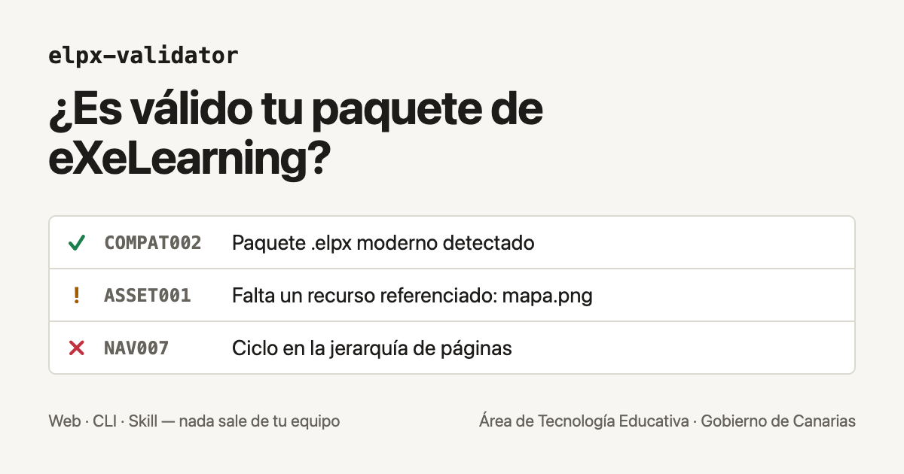

# elpx-validator

[](https://www.npmjs.com/package/elpx-validator)
[](https://github.com/ateeducacion/elpx-validator/actions/workflows/ci.yml)
[](https://ateeducacion.github.io/elpx-validator/)
[](https://codecov.io/gh/ateeducacion/elpx-validator)

[](https://ateeducacion.github.io/elpx-validator/)

[Español](README.es.md)

An inspector, validator, asset explorer and preview tool for **eXeLearning** packages (`.elpx` and legacy `.elp`). The same validation runs three ways:

- **Web app** — <https://ateeducacion.github.io/elpx-validator/>. Everything happens in the browser; no file is uploaded and the page loads nothing from other sites.
- **CLI** — `npx elpx-validator course.elpx`, for scripts and CI. See [CLI](#cli).
- **Agent Skill** — for AI assistants. See [Agent Skill](#agent-skill).

---

## Features

### Supported Formats
| Format | Manifest | Description |
|--------|----------|-------------|
| **Modern `.elpx`** | `content.xml` (ODE 2.0) | Full validation with deep structural and semantic checks |
| **Legacy `.elp`** | `contentv3.xml` | Basic metadata extraction with format-appropriate pipeline |

The validator auto-detects the format and applies the correct validation pipeline. A badge (`Modern ELPX` / `Legacy ELP`) is shown in the results.

### Validation Scope

The validator performs **layered validation** organized into categories:

#### 1. Package / ZIP layer (`PKG*`)
- Presence of required files: `content.xml`, `content.dtd`, `index.html`
- Recommended directories: `html/`, `content/resources/`, `theme/`, `libs/`, `idevices/`
- Path traversal detection (`../`)
- Absolute path detection
- Suspicious files (`.DS_Store`, `Thumbs.db`, executables)
- Duplicate normalized paths (casing conflicts)

#### 2. XML / Schema layer (`XML*`)
- XML well-formedness
- Root element is `<ode>`
- Namespace validation (`http://www.intef.es/xsd/ode`)
- `version` attribute presence
- `DOCTYPE ode SYSTEM "content.dtd"` detection
- Expected root child ordering: `userPreferences?`, `odeResources?`, `odeProperties?`, `odeNavStructures`
- Unknown root child elements

#### 3. Navigation / Structure layer (`NAV*`)
- Page, block, and component ID presence and uniqueness
- Parent page reference validation (dangling references)
- Page hierarchy cycle detection
- Sibling ordering consistency
- Component containment validation (page/block ID matches)
- Order field numeric validation

#### 4. Metadata layer (`META*`)
- `odeId` and `odeVersionId` format validation (14-digit timestamp + 6 uppercase alphanumeric)
- `eXeVersion` presence
- Project title (`pp_title`) presence

#### 5. iDevice layer (`IDEV*`)
- Type recognition against a registry of **18 known iDevice types** from the ELPX specification
- `jsonProperties` parseability
- `htmlView` content check
- Type-specific validation:
  - Image iDevices (`image-gallery`, `magnifier`): image asset references
  - URL iDevices (`external-website`): URL presence
  - Download iDevices (`download-source-file`): `isDownload` flag consistency

#### 6. Asset layer (`ASSET*`)
- Complete asset inventory from the ZIP
- Reference extraction from `htmlView`, `jsonProperties`, and exported HTML
- `{{context_path}}` template variable normalization
- Missing asset detection (referenced but not present)
- Orphaned asset detection (present but never referenced)
- Casing mismatch detection
- Path traversal in references

### Known iDevice Types

The registry includes these documented types, classified by validation depth:

| Type | Group | Validation |
|------|-------|-----------|
| `text` | Content | Deep |
| `image-gallery` | Media | Deep |
| `magnifier` | Media | Deep |
| `external-website` | Embed | Deep |
| `download-source-file` | System | Deep |
| `form`, `matching`, `sort`, `classify`, `guess`, `checklist`, `crossword` | Activity | Shallow |
| `casestudy`, `rubric` | Content | Shallow |
| `trueorfalse`, `quick-questions`, `quick-questions-multiple-choice` | Quiz | Shallow |
| `complete` | Activity | Shallow |

Unknown/custom iDevice types are reported as informational findings, not errors.

### Asset Explorer

The Assets tab provides:
- Full inventory of all files in the package with MIME type, extension, and preview capability
- Filtering: All / Referenced / Orphaned / Missing
- Summary counts: total, referenced, missing, orphaned

### Preview System

The Preview tab provides:
- Sandboxed `<iframe>` preview of `index.html` and pages under `html/`
- Asset references rewritten to Blob URLs for offline rendering
- Page selector dropdown

### User Interface

The redesigned UI is organized as a **navigable inspector**:

| Tab | Content |
|-----|---------|
| **Overview** | Legacy checklist, package metadata, file size |
| **Findings** | All validation findings with severity/category filtering |
| **Pages** | Hierarchical page tree with blocks and components |
| **iDevices** | Type summary, counts, known/unknown classification |
| **Assets** | Full asset inventory with filtering |
| **Preview** | Sandboxed page preview |
| **EDIA Validation** | The 48 EDIA quality criteria for open educational resources: 13 automatic, 12 heuristic, 23 for manual review |

The header has the shortcuts to the CLI and the Skill, the language (English / Spanish) and the colour mode, which follows the system until you choose one. The footer shows the version, the source and the licences.

Each finding includes:
- **Rule code** (e.g., `PKG001`, `XML004`, `NAV012`, `IDEV007`, `ASSET015`)
- **Severity**: error / warning / info
- **Category**: package / xml / navigation / metadata / idevice / asset / compatibility
- **Detailed explanation**
- **Location** (page, block, iDevice)
- **Evidence** (raw data supporting the finding)
- **Repair suggestion**

---

## Validation Rule Catalog

| Code Range | Category | Examples |
|-----------|----------|----------|
| `PKG001`–`PKG017` | Package | Missing files, path traversal, suspicious names, missing/invalid `screenshot.png`, legacy v3 UUID-pattern subfolders under `content/resources/` |
| `XML001`–`XML008` | XML/Schema | Malformed XML, wrong root, namespace, ordering |
| `NAV001`–`NAV022` | Navigation | Missing IDs, duplicates, cycles, containment |
| `META001`–`META006` | Metadata | Missing/invalid odeId, odeVersionId, title |
| `IDEV001`–`IDEV006` | iDevice | Unknown types, parse errors, missing assets/URLs |
| `ASSET001`–`ASSET005` | Asset | Missing, orphaned, path traversal, casing |
| `COMPAT001`–`COMPAT002` | Compatibility | Legacy/modern format detection |

---

## Getting Started

1. Open `index.html` in a modern browser. No build step is required.
2. Drop an `.elp`, `.elpx`, or `.zip` file onto the drop zone or click it to choose a file.
3. Review the validation results across the different tabs.

---

## CLI

Needs Node.js 22 or later. Nothing to install: `npx` downloads the package the first time.

```bash
npx elpx-validator course.elpx                 # findings as text
npx elpx-validator course.elpx --strict        # warnings also fail (for CI)
npx elpx-validator course.elpx --json --edia   # full report, with the EDIA criteria
npx elpx-validator *.elpx --lang es -o informe.txt
```

| Option | Effect |
|--------|--------|
| `--json` | The report as one JSON document (an array when several files are given) |
| `--strict` | Warnings also make the package fail |
| `--all` | Also list informational findings |
| `--edia` | Add the EDIA quality criteria evaluation |
| `-o, --output FILE` | Write to `FILE` instead of standard output |
| `--lang es\|en` | Language of the text output (default: from `LANG`) |
| `--no-color` | Plain text without colours |

**Exit status:** `0` valid (warnings allowed unless `--strict`), `1` invalid, `2` the command could not run (bad option, unreadable file).

The JSON report has `file`, `format` (`elpx`, `elp` or `unknown`), `verdict` (`valid`, `valid-with-warnings` or `invalid`), `counts`, `findings[]`, `metadata`, `pages[]`, `ideviceSummary`, `assetSummary` and, with `--edia`, `edia`.

### As a library

```js
const { validateBuffer } = require('elpx-validator/cli');
const report = await validateBuffer(fs.readFileSync('course.elpx'), { edia: true });
```

`require('elpx-validator')` is the validator itself (`runFullValidation(zip)` takes a JSZip instance and needs a global `DOMParser`); `validateBuffer` sets both up in Node.

## Agent Skill

[`skills/elpx-validator/SKILL.md`](skills/elpx-validator/SKILL.md) teaches AI assistants (Claude Code, Copilot and others that read Agent Skills) to validate packages with the CLI and explain the findings.

```bash
npx skills add ateeducacion/elpx-validator
# or
gh skill install ateeducacion/elpx-validator elpx-validator
```

---

## Architecture

The codebase follows a modular architecture:

```
index.html                    # Application shell
styles.css                    # Styling for the UI
js/
├── core/
│   ├── rules.js              # Rule catalog and finding factory
│   └── model.js              # Normalized project model builder
├── registries/
│   └── idevice-types.js      # Known iDevice type registry
├── validators/
│   ├── package-rules.js      # ZIP/package structure validation
│   ├── xml-rules.js          # XML schema validation
│   ├── nav-rules.js          # Navigation/ID/reference validation
│   ├── idevice-rules.js      # iDevice type validation
│   └── asset-rules.js        # Asset inventory and validation
├── preview/
│   └── virtual-fs.js         # Blob URL virtual filesystem
├── edia/                     # EDIA criteria (evaluation and view)
├── i18n/                     # English and Spanish texts
├── validator.js              # Main orchestrator (new + legacy API)
├── cli.js                    # Command line (Node only)
├── shell.js                  # Header and footer: language, colour mode, panels, version
├── theme.js                  # Colour mode
└── app.js                    # UI layer
bin/elpx-validator.js         # CLI entry point
skills/elpx-validator/        # Agent Skill
vendor/jszip.min.js           # JSZip for the web app (copied by `bun run vendor`)
tests/                        # Unit tests (bun test)
```

All validation rules return structured finding objects:

```js
{
  code: 'IDEV001',
  severity: 'info',
  category: 'idevice',
  message: 'Unknown iDevice type',
  details: 'The component uses an iDevice type not in the known registry.',
  location: { pageId: '...', blockId: '...', ideviceId: '...' },
  evidence: { odeIdeviceTypeName: '...' },
  suggestion: 'Verify whether this is a custom iDevice or a typo.'
}
```

---

## Development

### Requirements

- A modern browser (Chrome, Firefox, Safari, Edge)
- Node.js 22 or later (for the CLI)
- Bun canary (for the tests, the linter and the formatter)

### Running locally

Open `index.html` in a browser, or start a local HTTP server:

```bash
bun start
```

By default it listens on `http://localhost:8081`.

### Running tests

The tool chain is [Bun](https://bun.com) canary (`bun upgrade --canary`): `bun test`, `bun lint` and `bun fmt`.

```bash
bun ci
bun test                # all tests
bun run test:coverage   # with the per-file coverage thresholds CI enforces
bun run lint            # bun lint + bun fmt --check
bun run fix             # apply the lint fixes and the formatting
```

The tests cover the rules, the project model, each validation layer, the EDIA criteria, the translations, the page shell (header, footer, panels) and the CLI, including the real `bin` script in plain Node.

After updating the `jszip` dependency run `bun run vendor`; a test fails while the copy in `vendor/` is stale.

### Releasing

Change `version` in `package.json` and `VERSION` in `js/shell.js` (a test keeps them equal), then publish a GitHub release tagged `v<version>`. The release workflow publishes the package to npm when the repository variable `NPM_PUBLISH` is `true`; it uses npm trusted publishing (OIDC), so the package needs this repository configured as a trusted publisher on npmjs.com. The web app is the repository itself, served by GitHub Pages from `main`.

---

## Known Limitations

- **DTD validation**: True DTD validation is not feasible in the browser. The tool checks for the DOCTYPE declaration and `content.dtd` presence but does not validate XML against the DTD.
- **Legacy `.elp`**: Limited to metadata extraction. Deep structural validation requires the modern `content.xml` format.
- **Preview fidelity**: HTML preview uses Blob URLs for assets, which may not perfectly replicate server-side behavior for all resource types.
- **iDevice depth**: Only a subset of iDevice types have deep validation. Custom iDevices are flagged as informational only.
- **Cross-check**: XML vs. exported HTML cross-checking is reference-based only; full structural comparison is a future enhancement.

---

## Credits

Built by the [Área de Tecnología Educativa](https://www3.gobiernodecanarias.org/medusa/ecoescuela/ate) – Gobierno de Canarias.

References:
- [eXeLearning](https://github.com/exelearning/exelearning)
- [ELPX Format Specification](https://github.com/exelearning/exelearning/blob/main/doc/elpx-format.md)
